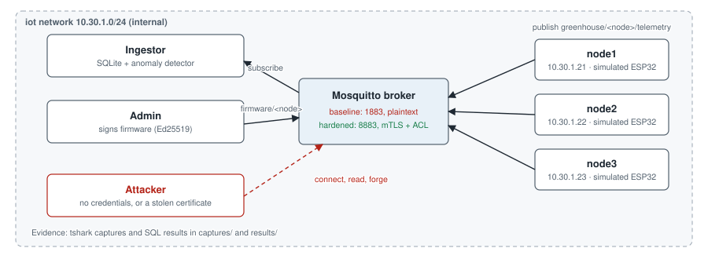
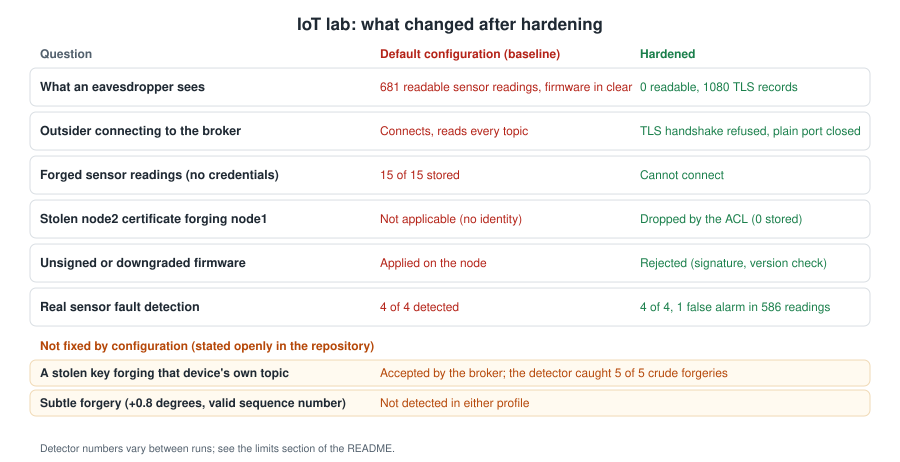

# Greenhouse IoT Lab: secure MQTT data pipeline with anomaly detection

A simulated greenhouse monitoring system running in Docker, used to **measure what an attacker can do to a
typical (tutorial-grade) MQTT/IoT deployment, apply security controls, and re-measure**. It is the third lab
of the series ([5G SA lab](https://github.com/derrah-mustapha/5g-sa-security-lab), [4G LTE lab](https://github.com/derrah-mustapha/4g-lte-security-lab), this IoT lab) and uses the same baseline-vs-hardened method.

- 3 simulated **ESP32 nodes** (Python): temperature, humidity, soil moisture; node3 has a real sensor fault every 40th reading
- **Mosquitto 2.0** MQTT broker
- **Gateway/ingestor**: stores readings in SQLite and flags anomalies (range check, sequence check, robust z-score)
- **Firmware updates** over MQTT (`firmware/<node>`), Ed25519 signatures in the hardened profile
- **Attacker** and **admin** containers, tcpdump sidecar + tshark for the evidence
- One isolated Docker network `10.30.1.0/24` (no internet, nothing published on the host)

## Architecture



Topics: `greenhouse/<node>/telemetry` (device -> gateway), `firmware/<node>` (admin -> device), `bench/x` (latency test).

## Profiles

| | baseline (tutorial defaults) | hardened |
|---|---|---|
| Transport | plaintext, port 1883 | TLS 1.2/1.3 only, port 8883 |
| Authentication | anonymous | mutual TLS: every client needs a certificate signed by the lab CA |
| Authorisation | none | ACL: a device publishes only `greenhouse/<its CN>/telemetry` and reads only its own `firmware/` topic; the gateway only reads telemetry; only `admin` writes firmware |
| Firmware | applied without checks | Ed25519 signature + monotonic version required |
| Gateway | same detector in both profiles | same |

## Run it

Requirements: Linux, Docker + Compose v2, openssl, about 1 GB free RAM, internet the first time (images, pip).

```bash
docker build -t iot-lab-py:1 docker        # once
scripts/lab.sh up baseline                 # generates certs (first time), starts everything, ~20 s
scripts/run_experiments.sh baseline        # about 3 minutes -> results/baseline.md, captures/baseline.pcap
scripts/lab.sh up hardened
scripts/run_experiments.sh hardened
scripts/lab.sh status
scripts/lab.sh down
```

Manual attacks (inside the attacker container):

```bash
docker compose exec attacker python /app/attack.py sniff --secs 5
docker compose exec attacker python /app/attack.py crude --target node1
docker compose exec admin python /app/fw_publish.py --node node1 --version 3 --sign
docker compose exec ingestor python /app/q.py "select node,count(*),sum(anomaly) from readings group by node"
```

## Findings (see `results/` and `captures/`)



| # | Question | Baseline | Hardened |
|---|---|---|---|
| E1 | What does an eavesdropper see? | 1289 readable MQTT publishes, 681 sensor readings, firmware messages, all in clear | 0 readable; 12 TLS handshakes, 1080 encrypted records |
| E2 | Can an outsider read everything? | Yes: connects with no credentials, receives all topics | No: TLS handshake refused without a certificate; port 1883 closed; a device with a stolen cert reads 0 messages from other topics |
| E3 | Can an attacker inject readings? | Yes: 15/15 forged readings stored. Detector caught 5 of 15 in the last run (crude yes, +4 degrees borderline, +0.8 degrees never) | No-credential forgery impossible. Stolen node2 cert forging node1: dropped by ACL (0 stored). Stolen cert forging node2's own topic: accepted by the broker, flagged by the detector (5/5) |
| E4 | Does anomaly detection work? | 4/4 real sensor-fault spikes detected | 4/4, 1 false alarm in 586 readings |
| E5 | Firmware integrity | Attacker's unsigned v99 applied; unsigned v100 from an "insider" applied; rollback to v1 applied | Attacker cannot connect; unsigned image rejected; rollback rejected; legitimate signed v2 accepted |
| E6 | Cost | 0.22 ms mean round trip, 275 msg/s | 0.25 ms, 271 msg/s (persistent connection; handshake cost not included) |

## Limits and honest notes

- **Simulated devices.** The nodes are Python processes, not ESP32 firmware; there is no flash, secure boot, or hardware key storage, and no radio layer (Wi-Fi/BLE/LoRa).
- **A stolen device key still lets an attacker lie about that one device's own readings.** The broker cannot know; only the detector can, and a subtle forgery (+0.8 degrees with a plausible sequence number) is not detected in either profile. Real deployments add per-device revocation (CRL/OCSP), key storage in a secure element, and cross-sensor plausibility checks.
- **Detector side effect.** An undetected forged sequence number makes the next legitimate readings look like replays (10 false alarms in the baseline run). Large jumps are flagged without updating state, which fixed the poisoning case seen in the first hardened run.
- **Detector numbers vary** run to run (noise is random); the +4 degrees forgery was flagged 10/10 once and 5/10 another time.
- **Ground-truth marker.** Forged messages carry `"src": "attacker"` so the evaluation can count them; a real attacker would not label them.
- **Certificates and keys are generated locally** by `scripts/gen_certs.sh` (lab CA, device certificates, firmware-signing key) and are not part of the repository. Never reuse them anywhere else.
- **No dashboard** (Grafana/Node-RED): the evidence is in SQLite queries and tshark output. A dashboard would not change the security findings.
- Latency is measured on loopback inside one machine, so it says nothing about real Wi-Fi/cellular links or TLS handshake cost on a microcontroller.

## Licensing

Own code and documentation: MIT (see `LICENSE`). Runs the official `eclipse-mosquitto` image (EPL-2.0 / EDL-1.0) and Python libraries `paho-mqtt` and `cryptography`.
